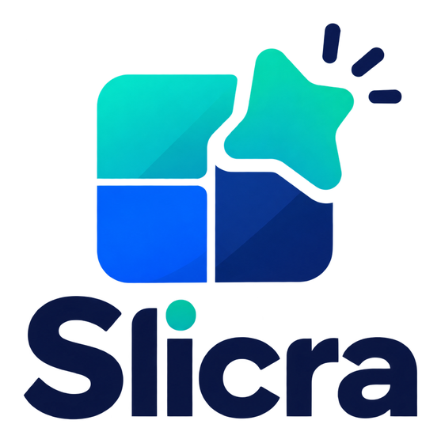
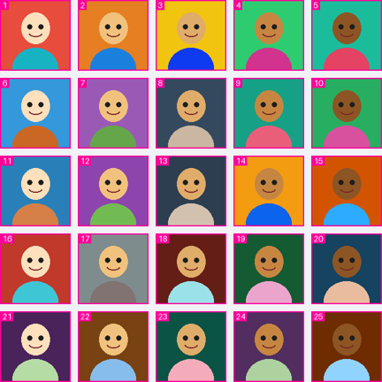
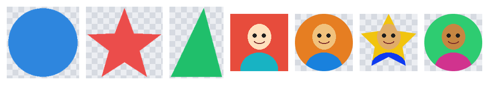

<p align="center">
  
</p>

<p align="center">
  <strong>Cut one image into many: grids, sprite sheets and irregular shapes, each exported as its own file with any mask you want. Local, deterministic, no AI, no cloud.</strong>
</p>

<p align="center">
  <a href="README.es.md">Español</a> ·
  <a href="#quickstart">Quickstart</a> ·
  <a href="#detection-modes">Detection modes</a> ·
  <a href="#python-api">Python API</a> ·
  <a href="#agent-skill">Agent Skill</a>
</p>

---

Slicra **detects** regions in an image (a grid of avatars, stickers on a sheet, shapes on a
transparent canvas) and **extracts** each one as an individual PNG/WebP/JPEG. Detection and masking
are independent: a square grid cell can be exported as a circle or a star, and a detected star can be
exported as its bounding rectangle.

| Preview (what will be cut) | Cut-outs (transparent PNGs, any shape) |
| --- | --- |
|  |  |

- **Preview first.** `slicra preview` draws every region with its index before you export anything.
- **One engine, three interfaces.** Python library, `slicra` CLI and a portable Agent Skill share
  the same pipeline.
- **Honest output.** Warnings, heuristic scores and explicit failures instead of silent guesses. Zero
  regions is an error, never a success.
- **Safe by default.** The source image is only read, existing files are never overwritten without
  `--overwrite`, file names cannot escape the output directory, and YAML is read with `safe_load`.
  No network calls, no telemetry.

## Installation

```bash
python -m pip install slicra             # core: grid, grid-auto, manual
python -m pip install "slicra[opencv]"   # adds the contours detector (NumPy + OpenCV headless)
```

Slicra is not yet published on PyPI. Until it is, install from a checkout:

```bash
git clone https://github.com/DailybotHQ/slicra.git && cd slicra
python -m pip install -e ".[opencv]"
```

Requires Python 3.11+. Works on Linux, macOS and Windows (no desktop GUI libraries needed).
SVG input/masks are not supported yet.

## Quickstart

```bash
python examples/generate_fixtures.py                       # synthetic demo images in examples/input/

# 1. 5x5 avatar sheet -> 25 PNGs + preview.png + manifest.json
slicra extract examples/input/avatars-grid.png \
  --mode grid --rows 5 --cols 5 --gap-x 12 --gap-y 12 --output output/avatars

# 2. Irregular shapes -> transparent cut-outs that keep each silhouette
slicra extract --config examples/configs/irregular-shapes.yaml

# 3. A whole folder of sheets, every crop in one flat folder
slicra extract examples/input --mode grid-auto --output output/all --flat
```

Each run writes one image per region, a `preview.png` with numbered boxes and a `manifest.json`
describing every region and file.

## Detection modes

| Mode | Use it for | How it works |
| --- | --- | --- |
| `grid` | Sheets with known, regular geometry | Boxes computed from `rows`, `cols`, `margins`, `gap_x`/`gap_y` (or explicit cell sizes) |
| `grid-auto` | Avatar sheets and mosaics whose spacing is not exact | Finds separator rows/columns of background color; fails if it finds no separators or not the `rows`/`cols` you expect |
| `contours` | Disjoint objects on a plain or transparent background | Threshold against background/alpha, optional morphology, connected components; keeps each exact silhouette |
| `manual` | Specific areas, or anything detection gets wrong | Rectangles and polygons in source pixel coordinates, from YAML/JSON |
| `auto` | Not sure | Tries `grid-auto`, then `contours`; records which one it picked and why |
| `template` | Reusable presets | Loads a built-in preset (`slicra templates`) or your own YAML |

`contours` does not separate overlapping objects and is not a semantic segmenter for photos; it
warns when the background is not uniform.

### Grid vocabulary

```
| margin.left | cell | gap_x | cell | gap_x | cell | margin.right |
```

- **gap**: space *between* cells. Never part of a crop.
- **margin**: space around the whole grid.
- **crop_padding**: grows each crop box after detection (clamped to the image).
- **shape_inset**: shrinks the mask inside its box.

When the usable width is not divisible by the number of cells, cell sizes differ by at most one pixel,
the remainder is spread deterministically, and cells never overlap or touch a gap.

## Shapes, transparency and resize

| `extraction.shape` | Result |
| --- | --- |
| `rectangle` | Every pixel of the crop box |
| `ellipse` / `circle` | Anti-aliased mask; `circle_fit: contain` keeps the box, `center-square` crops to a centered square first |
| `star` | `points` (>= 3), `inner_ratio`, `outer_ratio`, `rotation` |
| `polygon` | The region's own polygon, or `extraction.polygon.points` relative to the box (never guessed) |
| `original` | The detected silhouette (contours, `grid-auto` with `silhouette: true`) or manual polygon; a plain box otherwise |

PNG (default) and WebP keep real transparency outside the mask. JPEG has no alpha channel: images are
flattened against `output.background` (white by default) and a warning is recorded.

`output.resize` supports `contain` (default: fit inside, no distortion, transparent or `background`
padding), `cover` (fill and center-crop) and `stretch` (exact size, may distort).

## Configuration

Precedence is **CLI flags > YAML > defaults**. Unknown keys are errors.

```yaml
version: 1
input:
  path: examples/input/avatars-grid.png
detection:
  mode: grid
  rows: 5
  cols: 5
  margins: {left: 0, top: 0, right: 0, bottom: 0}
  gap_x: 12          # a property of this image, not a universal default
  gap_y: 12
extraction:
  shape: rectangle
  crop_padding: 0
output:
  directory: output/avatars
  format: png
  naming: "avatar_{index:03d}"   # fields: index, row, col, id, stem
  overwrite: false
  resize: {width: 256, height: 256, mode: contain}
preview:
  enabled: true
manifest:
  enabled: true
```

More examples in [`examples/configs/`](examples/configs): irregular shapes with `contours`, a
[manual sheet](examples/configs/manual-shapes.yaml) that cuts an oval, a star and a triangle from
the same image, real-world avatar sheets with `grid-auto`, and circular avatars from a template.
Full reference: [`skills/slicra/references/configuration.md`](skills/slicra/references/configuration.md).

## CLI

```bash
slicra --version
slicra init --output slicra.yaml [--mode grid|grid-auto|contours|manual]
slicra validate --config slicra.yaml
slicra inspect input.png --config slicra.yaml [--json]            # writes nothing
slicra preview input.png --config slicra.yaml --output preview.png
slicra extract input.png --config slicra.yaml --output ./out
slicra extract ./input-images --config slicra.yaml --output ./batch-out [--flat]
slicra templates
```

Exit codes: `0` ok · `2` invalid configuration/usage · `3` detection failed or found zero regions ·
`4` image not loadable · `5` output conflict · `6` missing optional dependency.

Batch mode processes every image directly inside the folder, writes `<output>/<stem>/` per image (or
everything into `<output>` with `--flat`, plus `_manifests/` and `_previews/`), never reads its own
outputs and keeps going when one image fails.

## Python API

```python
from slicra import ImageSlicer

slicer = ImageSlicer.from_config("slicra.yaml")
result = slicer.extract("avatars.png", output_dir="avatars")
print(result.region_count, result.manifest_path)

# No files: detect, render in memory, preview
detection = ImageSlicer.from_dict({"detection": {"mode": "grid-auto"}}).detect("avatars.png")
for region in detection.regions:
    print(region.index, region.id, region.bbox.as_tuple(), region.row, region.col)

crops = ImageSlicer.from_dict({"detection": {"mode": "grid-auto"}, "extraction": {"shape": "circle"}}).render("avatars.png")
crops[0].image.save("first.png")   # PIL.Image
```

`extract_batch(input_dir, output_dir, flat=False)` processes a folder. Errors derive from
`SlicraError` and carry the same exit codes the CLI uses.

## Agent Skill

[`skills/slicra/`](skills/slicra) is a portable [Agent Skill](https://agentskills.io/specification)
that teaches a coding agent to inspect, preview and extract with the installed `slicra` CLI. It is
validated with the reference validator (`agentskills validate skills/slicra`).

- **Claude Code**: copy or symlink the folder to `.claude/skills/slicra/` (project) or
  `~/.claude/skills/slicra/` (personal).
- **Other agents**: `npx skills add https://github.com/DailybotHQ/slicra --skill slicra`
  installs it where your agent looks for skills. Skill folders differ between agents and versions;
  check your agent's documentation if it does not pick it up.

The skill only calls the local CLI: images never leave the machine.

## Limitations

- `contours` needs separable objects on a plain or transparent background; it does not split
  overlapping objects or segment photographs.
- `grid-auto` needs separators that are close to a single background color.
- Scores are heuristic quality indicators, not calibrated probabilities.
- SVG and AI segmentation are not implemented. Detectors are registered through
  `slicra.register_detector`, which is the extension point for them.

## Development

```bash
python -m pip install -e ".[dev]"
python -m pytest              # includes building and installing the wheel in a clean venv
ruff check src tests examples && ruff format --check src tests examples && mypy
```

See [CONTRIBUTING.md](CONTRIBUTING.md) (including how to add a detector or a mask),
[AGENTS.md](AGENTS.md) for AI coding agents, and [docs/](docs/README.md) for architecture and
standards.

## License

[MIT](LICENSE)
